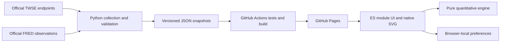

# Architecture

The explicit deployment target is GitHub Pages, so this release intentionally uses a static application and a scheduled batch backend rather than a web-server/database stack.

`scripts/update_data.py` provides instrument registry enrichment, explicit month-based backfill, incremental merging, schema/OHLC validation, date normalization and source reporting. JSON observations are the versioned persistence layer; Git provides revision history. No invented HTTP backend contracts are advertised.

`engine.js` is deterministic and independently testable. `app.js` loads one cached snapshot per dataset per refresh and computes only the core covered histories. Full-market screening uses snapshots, not per-symbol network downloads. Quant functions are separate from explanation generation. Personal settings do not leave the browser.

`scripts/build.mjs` emits content-hashed JavaScript/CSS filenames, rewrites transitive module imports, and copies the explicit application assets and data directory into dist. `build.json` records the asset map; old engine/app versions cannot be mixed by browser cache. Hash routing works beneath `/stock-integrated/`; no domain-root asset paths are used. Runtime has no npm dependencies. Playwright is pinned as a development dependency.

A future server adapter can replace static data reads when authentication, secure LLM calls, intraday ingestion or large datasets justify it. GitHub Actions is not an authentication service.
